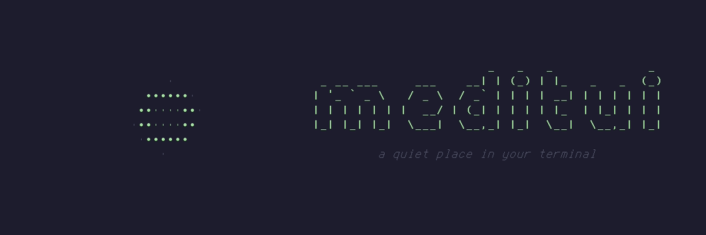
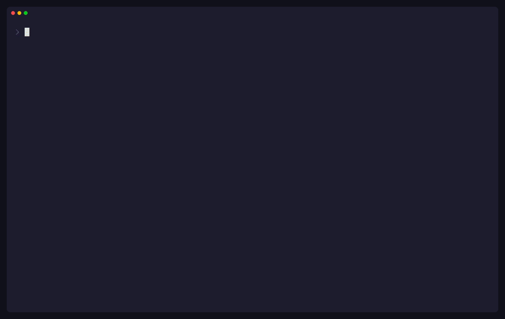

<p align="center">
  
</p>

# meditui

Guided meditation and breathing in your terminal. I wanted to get some
meditation in between coding sessions without switching apps, so I made
this.



- Breathing exercises and guided meditations, sorted into folders by
  what they're for, with a Start here folder for the basics
- A walkthrough the first time you do a meditation: a few short steps,
  then slow breaths with the circle that ease into the real pace
- A breathing circle to follow, with soft tones when the breath turns
- A pomodoro timer whose breaks can be a short meditation
- Stats and a year-long practice heatmap
- Your own meditations, written as small TOML files ([recipes](#recipes))

All sounds (a singing bowl, breath tones, brown noise, ocean) are generated
in code, so there are no audio files.

## Install

You need [Rust](https://rustup.rs). On Linux you also need the ALSA
headers for sound:

```sh
sudo apt install libasound2-dev pkg-config   # Debian, Ubuntu
sudo dnf install alsa-lib-devel              # Fedora
sudo pacman -S alsa-lib                      # Arch
```

Then:

```sh
cargo install --git https://github.com/maxvolkan/meditui
```

This installs a command called `medi`. The first time you run it, a short
tour shows you the keys.

meditui is developed on Linux.

## Usage

```
medi              open the app
medi pomo         start a pomodoro (your last work/break lengths)
medi pomo 25/5    start a pomodoro: 25 min work, 5 min break
medi recipe       print an example recipe file
medi help         show help
```

### Keys

In the library:

| Key | |
| --- | --- |
| `↑` `↓` or `j` `k` | move |
| `←` `→` | close or open a folder |
| `Tab` | jump to the next folder |
| `Enter` | choose a meditation |
| `i` | replay the walkthrough for the selected meditation |
| `a` / `d` | add / delete your own meditation |
| `o` | show only office-safe meditations |
| `p` | pomodoro |
| `t` | stats |
| `s` | settings |
| `?` | replay the tour |
| `q` | quit |

New to meditation? Open the Start here folder and begin with Nadi Shuddhi.
Selecting a folder lists when to use each meditation in it.

After choosing a meditation, `←` `→` change the length by a minute and
`↑` `↓` by five, and `Enter` goes on. A short checklist helps you settle
in; skip it with `s`, or turn it off in settings.

The first time you do a meditation, a walkthrough shows you how, one short
step at a time. For a breathing pattern, the circle then starts with long,
slow breaths and speeds up to the real pace, and the session carries on
from there. `s` skips it, and `i` in the library replays it.

During a session, `Space` pauses and `Esc` ends early. Practices done with
the eyes closed start dim, with only the time and what to do right now, and
tones to keep time. `h` switches between the dim view and the circle.

### Tags and locks

Each meditation in the list has letters for where it's comfortable to do:

- `O` office-safe: nobody nearby would notice
- `E` eyes-open: the screen is the anchor, so you don't need to close your eyes
- `H` home-only: noticeable breathing, sounds or hand positions

A few practices build on another one. Anuloma Viloma usually comes after
two weeks of Nadi Shuddhi, for example. These are dimmed (`○`) until then.
It's a soft lock: you can always start anyway, and you can turn locks off
in settings.

## Recipes

A recipe is a meditation written as a TOML file. Put it in the recipes
folder and it shows up in your library the next time you start `medi`.

| OS | Recipes folder |
| --- | --- |
| Linux | `~/.config/meditui/recipes/` |
| macOS | `~/Library/Application Support/meditui/recipes/` |
| Windows | `%APPDATA%\meditui\recipes\` |

The quickest way to start is the built-in example, which explains every
option:

```sh
mkdir -p ~/.config/meditui/recipes
medi recipe > ~/.config/meditui/recipes/slow-box.toml
```

There are more examples in [`recipes/`](recipes/) in this repo, one for
each kind of guidance.

### Fields

| Field | Required | |
| --- | --- | --- |
| `name` | yes | Shown in the library. |
| `minutes` | yes | Default length, 1 to 180. You can still change it before you start. |
| `description` | no | Shown when the meditation is selected. |
| `category` | no | Which folder it goes in: `start_here`, `focus_reset` (Focus), `down_regulation` (Calm down), `cognitive_defusion` (Untangle thoughts), `sensory_rest` (Rest your senses) or `deep_unwind` (Wind down). Without one, it goes in "Your own". |
| `tags` | no | Any of `office_safe`, `eyes_open`, `home_only`. |
| `when` | no | When it helps, in a few words. Shown when its folder is selected. |
| `walkthrough` | no | Short steps shown one at a time the first time (and with `i`). Breathing patterns then get a slow warm-up with the circle. |
| `eyes_closed` | no | `true` starts sessions in the dim view. |
| `prep` | no | Your own checklist before it starts, replacing the usual one. A list of short lines. |
| `interval_bell` | no | A soft chime every this many minutes. |
| `cues` | no | Text cues (see below). |
| `gaze` | no | `true` shows a still point instead of the breathing circle. Goes with `cues`. |
| `[[breath]]` | no | A breathing pattern (see below). |

### Kinds of guidance

A recipe has text cues, a breathing pattern, or neither.

#### Text cues

The session is split into equal parts, one per cue. Six cues in a
3-minute session means each one stays up for 30 seconds:

```toml
name = "Desk Reset"
minutes = 3
cues = [
    "Let your shoulders drop.",
    "Unclench your jaw.",
    "Open your hands.",
]
```

Add `gaze = true` to show a still point to rest your eyes on, instead of
the breathing circle.

#### Breathing pattern

A list of `[[breath]]` steps that repeats for the whole session:

```toml
name = "Longer Out-Breath"
minutes = 5

[[breath]]
label = "Breathe in"
seconds = 4
motion = "in"

[[breath]]
label = "Breathe out slowly"
seconds = 6
motion = "out"
```

Each step has:

- `label`: the text shown during that step. Write `LEFT` or `RIGHT` in
  capitals and an arrow shows that side, for alternate nostril breathing.
- `seconds`: how long it lasts, up to 600 (decimals are fine, like `0.75`)
- `motion`: what the circle does
  - `in`: grows
  - `out`: shrinks
  - `hold`: stays full
  - `hold_empty`: stays small
  - `rest`: breathe however you like while the circle drifts on its own

#### Silent sit

A recipe with only `name` and `minutes` has no guidance at all: just the
circle, the clock and the bells.

### When a recipe has a mistake

Typos and unknown fields are caught. A file that can't be used is
skipped, and you'll see a message naming the file and what's wrong. The
other recipes still load.

## Your data

Your settings, your own meditations and your time sat are saved in one
file:

| OS | |
| --- | --- |
| Linux | `~/.local/share/meditui/data.json` |
| macOS | `~/Library/Application Support/meditui/data.json` |
| Windows | `%APPDATA%\meditui\data.json` |

Nothing is sent anywhere.

## A note on safety

meditui isn't medical advice. Some of the breathing practices (fast
breathing like Kapalbhati and Bhastrika, and long breath holds) aren't a
good idea if you're pregnant or have high blood pressure, heart problems,
epilepsy or a history of panic attacks. Each one's description lists its
own cautions. If you feel dizzy or lightheaded, go back to normal breathing.

## Contributing

Bug reports, ideas and recipes are welcome. To share a recipe, add it to
[`recipes/`](recipes/) in a pull request. Please write cues in your own
words rather than copying them from a book, app or video.

Before sending a pull request, run:

```sh
cargo fmt
cargo clippy --all-targets
cargo test
```

The tests also check that every file in `recipes/` loads.

The GIFs in this README are recorded with [vhs](https://github.com/charmbracelet/vhs):
`vhs assets/demo.tape` and `vhs assets/banner.tape`. Each file says what to
build first.

I built meditui with a lot of help from Claude Code.

## Support

If meditui helps you, you can [buy me a coffee on Ko-fi](https://ko-fi.com/max_reformed).

## License

[MIT](LICENSE)
